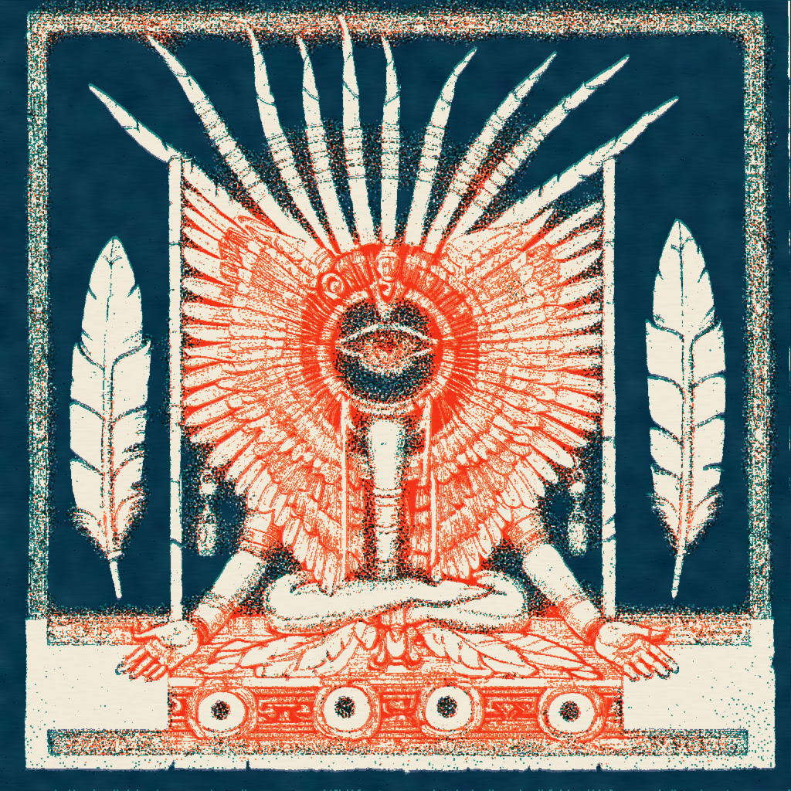
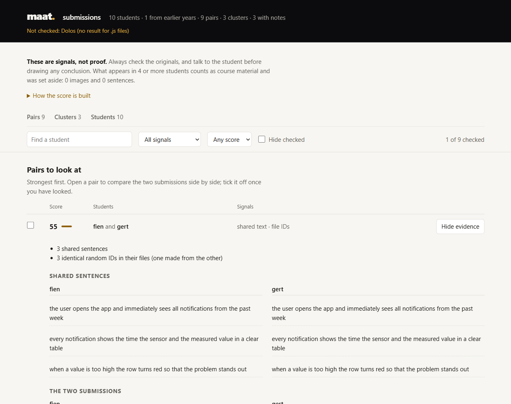
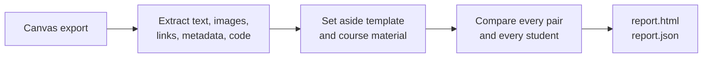

<p align="center">
  
</p>

<h1 align="center">maat</h1>

<p align="center"><i>
  In the Hall of Two Truths, the heart of the dead was laid on a scale against a single feather:<br>
  the feather of <b>Maat</b>, goddess of truth and order. Anubis watched the balance, Thoth wrote down<br>
  what it showed, and Osiris spoke the verdict. The scale itself never judged anyone.<br>
  It only showed what was there.
</i></p>

<p align="center">
  <b>A fraud checker for student submissions.</b><br>
  It weighs the evidence. You decide.
</p>

<p align="center">
  
  
  
</p>

---

Maat does the same for a stack of student work. Give it a Canvas export (Word, PDF, slides, images, code,
notebooks, exported projects) and it lays every submission next to every other one: reused images, shared and
paraphrased sentences, copied code, files made from someone else's file, traces of AI chats in links and metadata. One HTML report shows what tipped the
balance and why.

**Everything happens on your own machine. No student work is uploaded anywhere.**

<p align="center">
  <picture>
    <source media="(prefers-color-scheme: dark)" srcset="docs/report-dark.png">
    
  </picture>
</p>

## Quick start

```
npm install -g @vincentpeters/maat
maat "Assignment 3 submissions" --template assignment-3.docx -o report.html
```

Get the submissions from Canvas with **Download Submissions** on the assignment page and unzip them into a
folder. Then open `report.html`. You need [Node.js](https://nodejs.org) 22.18+ and [poppler](#install) for PDFs.

## What it weighs

> *Before the weighing, the dead recited the 42 declarations of innocence: "I have not stolen", "I have not
> lied". A student who hands in work makes the same claim. These are the things that can tip the balance.*

**Between two students**

| Signal | How | Weight |
|---|---|---|
| Same image | md5 or 16×16 grayscale (also rescaled or re-saved as JPEG), including images inside PDFs embedded in a docx | 50 |
| Same online document | both link to the same Google Doc, Miro board, Figma file, Canva design, ... | 40 |
| Identical random IDs | 3+ shared tool-made IDs (Word editing sessions, object IDs in exports and diagrams): one file was made from the other | 40 |
| Shared sentences | word 3-grams, also when lightly reworded | 5 per sentence, max 30 |
| Paraphrased sentences | multilingual sentence embeddings, from 2 sentences on | 4 per sentence, max 20 |
| Text similarity | [JPlag](https://github.com/jplag/JPlag) in text mode, with the template as base code | 50 × similarity |
| Code similarity | [Dolos](https://github.com/dodona-edu/dolos) across the whole project, only outliers relative to the class | 60 × similarity |
| Same suspicious generator | python-docx, headless browser, ... (+10 if created within 60 minutes of each other) | 15 |

**For one student**

- a link copied from an AI chat (`utm_source=chatgpt.com`, `chatgpt.com/`, `claude.ai/`, ...)
- an image that looks like a screenshot of an AI chat (OCR)
- many words in very little editing time (Word keeps count: was it pasted in?)
- a document made with a suspicious generator, or *last modified by* someone else
- a different tool or name in the metadata than in earlier assignments
- a visible link that points to a different site than the real link
- an export (JSON with an id per object) whose IDs are readable or sequential: written or generated, not exported by the tool

**Groups**: the same image or sentence in 3+ students is reported as a cluster.

**What everyone carries is not evidence.** The template, the assignment text and the school logo show up in
every submission. Anything that appears in 15% or more of the class (at least 4 students) is treated as
course material and set aside; the report says how much was dropped that way.

## How it works



File names follow Canvas: `<student>_<id>_<id>_<original>`, and everything before the first `_` is the student.
Unpacked zips (folders) are read recursively; `venv`, `__pycache__`, `.git` and `node_modules` are skipped.
Code inside other files is compared as code: the code cells of Jupyter notebooks and the function nodes of
Node-RED flows go to Dolos, and a notebook's markdown counts as text. Exports and diagrams (`.json`,
`.drawio`, `.xml`, `.svg`) are not compared as text; only their IDs count.

## Install

```
npm install -g @vincentpeters/maat
```

Maat also needs **poppler** to read PDFs: `scoop install poppler`, `brew install poppler` or
`apt install poppler-utils`.

<details>
<summary><b>Optional helpers</b> (Maat says which ones it found and skips the rest)</summary>

| Helper | What it adds | Install |
|---|---|---|
| JPlag | text similarity | jar from the [releases](https://github.com/jplag/JPlag/releases) in `~/tools/jplag/` (or `--jplag`), plus Java 21+ |
| Dolos | code similarity | `npm install -g @dodona/dolos` |
| Tesseract | text inside images, AI-chat screenshots | with the `nld` and `eng` language data |
| Paraphrase model | paraphrased sentences | installed with Maat; the first run downloads ~470 MB to `~/.maat/models` |

</details>

From source: `git clone https://github.com/VincentPeters/maat.git`, then `npm install` and `npm link`.

## Usage

```
maat "<folder with submissions>" \
    --template "<blank assignment or template>" \
    --ignore-author "Teacher Name" \
    --ignore-image school-logo.png \
    --old "<submissions from last year>" \
    -o report.html
```

<details>
<summary><b>All options</b></summary>

| Option | |
|---|---|
| `--template <file>` | its text and images are ignored |
| `--old <folder>` | submissions from an earlier year (repeatable); only new ↔ old is compared |
| `--ignore-author <name>` | an author name that is expected, e.g. the teacher who made the template |
| `--ignore-image <file>` | an image to ignore, e.g. the logo in the report template |
| `--exclude <pattern>` | file name pattern to skip, e.g. `'*_feedback.txt'` (repeatable) |
| `--jplag <jar>` | path to the JPlag jar (default: newest `~/tools/jplag/jplag-*.jar`) |
| `--history <file>` | history across assignments (default `~/.maat/history.json`) |
| `--no-history` | don't read or update the history |
| `--no-ocr`, `--no-embed` | skip OCR or paraphrase detection (faster) |
| `-o, --output <file>` | the report (default `maat.html`) |

</details>

## The report

> *Thoth, the scribe of the gods, wrote down the outcome of every weighing.*

- `report.html`: the pairs to look at, strongest first, with search and filters; open a pair to see both
  students' images, sentences and file details side by side, tick it off once checked, or print it for a meeting.
  Also the clusters, code similarity and every student's metadata, and which checks could not run
- `report.json`: the same results, machine-readable
- `report_files/`: the JPlag and Dolos results; the report shows the commands to open them side by side
  (`java -jar jplag.jar -M VIEW ...`, `dolos serve ...`)

## The verdict is yours

> *A heart heavier than the feather was thrown to Ammit, the devourer. Maat has no Ammit.*

Every result is a **signal, not proof**. An editing time of 0 minutes also happens when a student pastes their
own work into a fresh document; two students writing about the same product will naturally write similar
sentences. Always check the originals, and talk to the student before drawing any conclusion.

## Privacy

- Submissions, reports and the history stay on your own computer. The report contains student names and
  images: don't share it or commit it to a repository.
- The history (`~/.maat/history.json`) keeps, per student, the assignment name, the tool used and the names
  found in the document metadata. Use `--no-history` if you don't want that.
- The only download is the paraphrase model (once). Nothing is ever uploaded.

## Claude Code skill

The repo ships a [Claude Code](https://claude.com/claude-code) skill in
[.claude/skills/maat/](.claude/skills/maat/SKILL.md). It picks the options, runs Maat and summarises the
report, without sending student work anywhere.

- **In this repo**: open Claude Code in the repo folder; the skill loads automatically.
- **Everywhere**: copy it to your personal skills folder:

  ```
  # macOS / Linux
  cp -r .claude/skills/maat ~/.claude/skills/
  # Windows (PowerShell)
  Copy-Item -Recurse .claude\skills\maat "$env:USERPROFILE\.claude\skills\"
  ```

Then type `/maat <folder with submissions>`, or just ask Claude to check a folder for copying.

## Development

```
npm install
npm test
```

The test builds a fake class (10 students and 1 from an earlier year) and checks every signal. JPlag, Dolos
and embeddings are off in the test; OCR is checked if Tesseract is installed.

## License

MIT, see [LICENSE](LICENSE).
